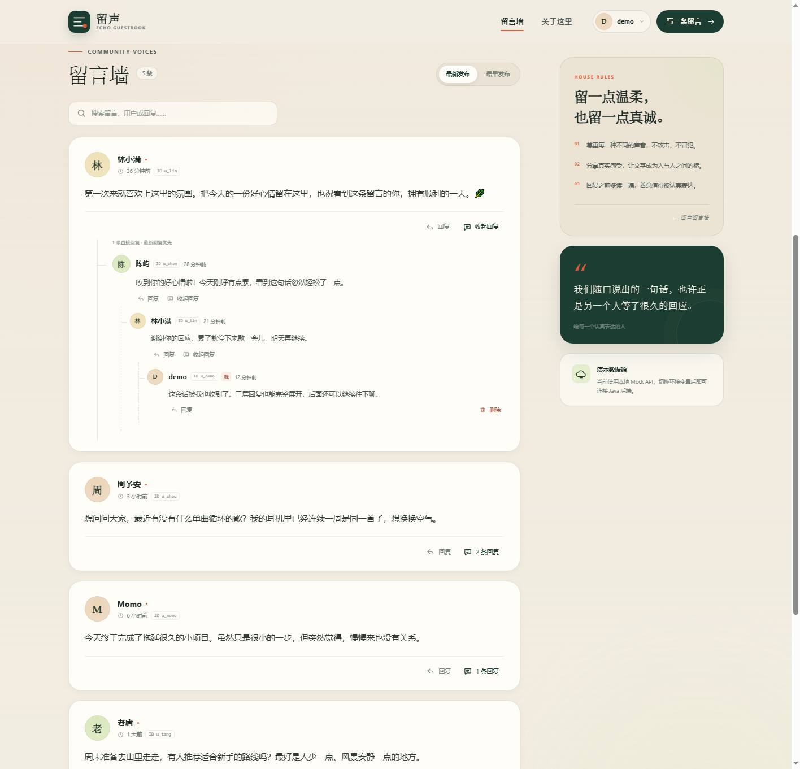

# 留声 ECHO · 前后端分离留言墙

基于 **Java 21 + Spring Boot 3.4 + React 18** 构建的前后端分离留言板项目。支持用户认证、时间排序、分页搜索、无限层级回复和级联删除，所有数据通过后端 API 读写 MySQL。



---

## 系统架构

```
用户（浏览器）
      │
      ▼
前端 frontend/  (React 18 + Vite，:5173)
      │  /api 代理到后端，无跨域
      ▼
后端 backend/  (Spring Boot 3.4，:8080)
      │
      ▼
应用层
  ┌────────────────────┬────────────────────┬───────────────────┐
  │ 认证                │ 留言模块            │ 回复模块            │
  │ Spring Security     │ 分页 / 排序 / 搜索  │ 无限层级 / 游标分页 │
  │ JWT + BCrypt        │ 软删除 + 汇总统计   │ 权限校验 + 级联删除 │
  └────────────────────┴────────────────────┴───────────────────┘
      │
      ▼
数据层
  ┌────────────────────────────┬───────────────────────────────┐
  │ MyBatis（mapper XML 分包）  │ Flyway（V1~V2 自动建表迁移）   │
  └────────────────────────────┴───────────────────────────────┘
      │
      ▼
MySQL 8.0  (naci_guestbook，utf8mb4)
```

---

## 核心特性

- **用户认证**：Spring Security + JWT 无状态登录，BCrypt 存储密码；注册 / 登录 / 恢复会话 / 退出四个接口，公开浏览无需登录。
- **留言模块**：分页查询（页码 OFFSET）、按时间升降序排序、关键词搜索（同时匹配留言内容、用户名和回复内容）、全站汇总统计。
- **无限层级回复**：数据库采用邻接表 `parent_id`，不建立自引用外键；查询按层加载，每次只查一层直接子回复，SQL 结构恒定、成本与层级无关，支持任意深度。
- **回复游标分页**：基于 `(created_at, id)` 游标（keyset）分页，沿 `(message_id, parent_id, created_at, id)` 索引定位，无 OFFSET 深翻页退化，多并发下不重不漏。
- **留言软删除 + 回复物理删除**：删除留言时事务内写 `messages.deleted_at` 立即返回，全部读路径与统计统一过滤；删除回复时在同一事务内按 `parent_id` 逐层收集后代并物理删除整棵子树（回复不用软删除的原因：留言是顶层节点，软删除只需过滤 `messages.deleted_at` 一个条件，不影响其他查询性能；而回复嵌套在树中，若软删除，每次查询子回复、统计计数都要沿祖先链校验父节点是否已删除，导致查询性能下降，因此选择在事务内一次性迭代删除整棵子树）。留言及其回复的物理清理由后台定时任务（MessageCleanupTask）分批执行，避免数据库 IO 突刺。
- **性能设计**：批量 `IN (...)` 查询回复计数避免 N+1；发布时快照 `user_name` 免 JOIN；回复树前端 O(n) 组装。

---

## 技术栈

| 类别 | 选型 | 用途 |
|------|------|------|
| 语言 | Java 21 | 后端主语言 |
| 应用框架 | Spring Boot 3.4.1 | Web / 依赖注入 / 安全 / 事务 |
| 安全 | Spring Security + JJWT 0.12.6 | JWT 无状态认证，BCrypt 密码散列 |
| ORM | MyBatis 3.0.4（Spring Boot Starter） | SQL 映射（mapper XML 按领域分包） |
| 数据库迁移 | Flyway | 启动时自动建表（V1~V2） |
| 持久化 | MySQL 8.0 | 用户 / 留言 / 回复存储 |
| 前端 | React 18.3.1 + Vite 5.4.21 + TypeScript 风格 JS | Web 交互界面 |
| 构建 | Maven 3.9+ / npm 9+ | 后端与前端构建 |

---

## 数据库设计

三张核心表，均使用 InnoDB + utf8mb4，时间字段一律 UTC（`DATETIME(3)`，毫秒精度，数据库自动生成）：

```text
users 1 ──── N messages 1 ──── N replies
（用户）        （顶层留言）        （回复，parent_id 邻接表自关联，支持无限层级）
                     │
                     └── deleted_at 软删除（V2 新增）
```

### users（用户）

| 字段 | 类型 | 说明 |
|------|------|------|
| id | BIGINT UNSIGNED AI | 主键 |
| username | VARCHAR(32) | 登录名，唯一索引 `uk_users_username` |
| password_hash | VARCHAR(100) | BCrypt 密码哈希 |
| display_name | VARCHAR(32) | 展示名称 |
| created_at / updated_at | DATETIME(3) | 注册 / 更新时间 |

### messages（顶层留言）

| 字段 | 类型 | 说明 |
|------|------|------|
| id | BIGINT UNSIGNED AI | 主键 |
| user_id | BIGINT UNSIGNED | 发布者，外键 → users.id（RESTRICT，禁止删除有留言的用户） |
| user_name | VARCHAR(32) | 发布时的展示名称**快照**，列表查询免 JOIN users |
| content | VARCHAR(500) | 留言内容，CHECK 约束非空白 |
| like_count | INT UNSIGNED | 点赞数缓存 |
| deleted_at | DATETIME(3) NULL | 软删除时间（V2 新增）；NULL = 未删除 |
| created_at / updated_at | DATETIME(3) | 发布 / 更新时间 |

索引：`idx_messages_created_at(created_at, id)` 支撑留言列表按时间翻页；`idx_messages_user_created_at` 支撑「我的留言」；`idx_messages_like_created_at` 支撑按热度排序；`idx_messages_deleted_at` 支撑后台清理任务扫描软删除留言。

### replies（留言回复）

| 字段 | 类型 | 说明 |
|------|------|------|
| id | BIGINT UNSIGNED AI | 主键 |
| message_id | BIGINT UNSIGNED | 所属留言，外键 → messages.id（**CASCADE**，留言物理删除时级联清理回复） |
| parent_id | BIGINT UNSIGNED NULL | 父回复 ID；NULL = 直接回复留言（第一层） |
| user_id | BIGINT UNSIGNED | 回复者，外键 → users.id（RESTRICT） |
| user_name | VARCHAR(32) | 回复时的展示名称快照 |
| content | VARCHAR(300) | 回复内容，CHECK 约束非空白 |
| like_count | INT UNSIGNED | 点赞数缓存 |
| created_at / updated_at | DATETIME(3) | 回复 / 更新时间 |

索引：`idx_replies_message_created_at` 支撑留言维度统计；`idx_replies_message_parent_created_at(message_id, parent_id, created_at, id)` 支撑**游标分页**——任意层级子回复查询沿索引直接定位，无 OFFSET 深翻页退化；`idx_replies_user_created_at` 支撑「我的回复」。

### 关键设计决策

- **邻接表 + 无自引用外键**：回复树仅靠 `parent_id` 表达层级。`parent_id` 故意不建自引用外键，规避 MySQL 自引用级联最多 15 层的限制；父回复的存在性与归属由写入事务校验并加锁。
- **软删除只作用于留言**：删除留言写 `deleted_at` 立即不可见，回复仍是物理删除（留言是顶层节点，软删除仅一个过滤条件不影响查询性能；回复嵌套在树中，软删除会使每次查询都要沿祖先链校验，性能下降）。
- **发布时名称快照**：`user_name` 冗余存储发布时刻的展示名，留言/回复列表零 JOIN。
- **物理清理异步化**：软删除留言由后台定时任务 MessageCleanupTask 先按 `message_id` 每批 500 条独立事务删除回复、再删留言本体；`ON DELETE CASCADE` 仅作残留数据兜底。

更完整的字段说明、SQL 示例与方案取舍见 [backend/docs/database-design.md](backend/docs/database-design.md)。

---

## 项目结构

```text
.
├─ frontend/                    React 前端
│  ├─ src/
│  │  ├─ api/                   后端 HTTP API 适配层
│  │  ├─ auth/                  登录会话上下文
│  │  ├─ components/            页面与交互组件
│  │  ├─ hooks/                 分页留言与回复树状态
│  │  └─ utils/                 时间格式化、头像、令牌存储工具
│  ├─ .env.example              前端环境变量模板
│  ├─ package.json
│  └─ vite.config.js            /api 代理到 localhost:8080
├─ backend/                     Spring Boot + SSM 后端
│  ├─ scripts/                  演示数据：demo_seed.sql 与生成脚本 generate_seed_data.py
│  ├─ docs/                     数据库与项目结构设计文档
│  └─ src/main/resources/
│     ├─ application.yml        后端配置（数据源、JWT 等）
│     └─ db/migration/          Flyway 迁移脚本（V1~V2）
├─ 要求.md                      需求说明
├─ 项目设计过程.md               设计过程记录
└─ preview.png
```

---

## 快速开始

### 第一步：环境准备

| 工具 | 版本要求 | 实测版本 | 检查命令 |
|------|----------|----------|----------|
| JDK | **21+** | 21 | `java -version` |
| Maven | 3.6.3+ | 3.9.9 | `mvn -v` |
| MySQL | 8.0+ | 8.0.40 | `mysql --version`（需支持 `utf8mb4`、CHECK 约束、窗口函数） |
| Node.js | 18+ | 18+ | `node -v`（Vite 5 要求） |
| npm | 9+ | 9+ | `npm -v` |

**Windows 一键安装**（PowerShell，需管理员权限；装完重新打开终端再验证）：

> `winget` 需要 Windows 10 1809+ 且已安装「应用安装程序（App Installer）」。若提示无法识别 `winget`，或下载太慢/失败，改用下面的手动安装方式。

```powershell
# JDK 21（Eclipse Temurin）
winget install EclipseAdoptium.Temurin.21.JDK

# Maven
winget install Apache.Maven

# MySQL 8.0（安装时按向导设置 root 密码，本文档默认 123456）
winget install Oracle.MySQL

# Node.js LTS（含 npm）
winget install OpenJS.NodeJS.LTS
```

**Windows 手动安装**（winget 不可用时的兜底，官网下载安装包双击安装）：

| 工具 | 下载地址 | 安装要点 |
|------|----------|----------|
| JDK 21 | https://adoptium.net/temurin/releases/?version=21 | 选 Windows x64 `.msi`，安装时勾选「Set JAVA_HOME」和「Add to PATH」 |
| Maven | https://maven.apache.org/download.cgi | 下载 Binary zip archive，解压到如 `D:\maven`，把 `bin` 目录加入系统 `PATH`（依赖上面配好的 `JAVA_HOME`） |
| MySQL 8.0 | https://dev.mysql.com/downloads/installer/ | 下载完整版 `mysql-installer-community`，安装时设置 root 密码（本文档默认 123456） |
| Node.js | https://nodejs.org/ | 下载 LTS `.msi`，一路下一步即可 |

安装后重新打开 PowerShell，逐条运行检查命令确认版本正确。MySQL 命令行工具若提示找不到，把 MySQL 的 `bin` 目录（如 `C:\Program Files\MySQL\MySQL Server 8.0\bin`）加入系统 `PATH` 后重试。

> **macOS**：`brew install openjdk@21 maven mysql node`，并按 brew 提示将 openjdk@21 链接到系统。

### 第二步：准备数据库

后端默认连接 `127.0.0.1:3306/naci_guestbook`，账号 `root/123456`（均可用环境变量覆盖，见下方表格）。首次部署只需创建空库，表结构由 Flyway 在后端启动时自动创建（V1 建表 → V2 留言软删除）。

```sql
CREATE DATABASE IF NOT EXISTS naci_guestbook
  DEFAULT CHARACTER SET utf8mb4
  COLLATE utf8mb4_0900_ai_ci;
```

命令行方式（PowerShell）：

```powershell
mysql -uroot -p123456 -e "CREATE DATABASE IF NOT EXISTS naci_guestbook DEFAULT CHARACTER SET utf8mb4 COLLATE utf8mb4_0900_ai_ci;"
```

（可选）导入演示数据：200 个用户、100 条常规留言（每条 10~20 层回复），外加 6 条极端数据示例（1000 层嵌套回复链、一层 1000 条回复、500/300 字满长度内容、emoji 与特殊字符、同一毫秒 100 条回复、1 条软删除不可见留言），导入后极端示例排在列表最前面。所有演示用户密码均为 `123456`，例如 `user001 / 123456`：

```powershell
mysql -uroot -p123456 --default-character-set=utf8mb4 naci_guestbook < backend\scripts\demo_seed.sql
```

> 注意：`demo_seed.sql` 的数据含固定主键，只能在空表（仅 Flyway 建表后）导入一次，重复导入会报主键冲突。

### 第三步：启动后端（端口 8080）

如需修改数据库连接或 JWT 密钥，先设置环境变量（均有默认值，本机演示可跳过）：

| 环境变量 | 默认值 | 说明 |
| --- | --- | --- |
| `DB_URL` | `jdbc:mysql://127.0.0.1:3306/naci_guestbook?...` | JDBC 连接串 |
| `DB_USERNAME` | `root` | 数据库用户名 |
| `DB_PASSWORD` | `123456` | 数据库密码 |
| `JWT_SECRET` | 内置开发密钥 | JWT 签名密钥（生产必须更换） |
| `JWT_EXPIRATION_MS` | `86400000` | 令牌有效期（24 小时） |

启动：

```powershell
cd backend
mvn spring-boot:run
```

首次会下载依赖（1~2 分钟）。启动时 Flyway 自动执行迁移建表，服务监听 `http://localhost:8080`。验证：

```powershell
# 返回留言分页 JSON 即为正常（注意 URL 加引号，& 在 PowerShell 中是命令分隔符）
curl "http://localhost:8080/api/messages?page=1&pageSize=1"
```

### 第四步：启动前端（端口 5173）

配置环境变量文件（可选，默认即连接后端）：

```powershell
cd frontend
Copy-Item .env.example .env
```

`.env` 内容：

```dotenv
VITE_API_BASE_URL=/api
```

安装依赖并启动：

```powershell
npm install
npm run dev
```

打开 <http://localhost:5173>。Vite 开发服务器已将 `/api` 代理到 `http://localhost:8080`，无需处理跨域；修改环境变量后需重启开发服务器。

### 第五步：验证部署

1. 打开 <http://localhost:5173>，页面底部显示「LIVE API」且统计数字与数据库一致，即前后端联通。
2. 注册一个账号并登录，发布一条留言、回复、删除，走通核心流程。
3. 如导入了演示数据，可直接用 `user001 / 123456` 登录查看。

页面统计区会显示留言总数、回复总数与今日新增；发布留言/回复需先注册或登录。

---

## 常用命令

```powershell
# 后端（在 backend/ 目录下）
mvn spring-boot:run        # 启动后端
mvn compile                # 编译
mvn package -DskipTests    # 打包 jar
mvn test                   # 运行测试
mvn clean                  # 清理

# 前端（在 frontend/ 目录下）
npm run dev                # 开发服务器（:5173）
npm run build              # 生产构建
npm run preview            # 预览生产构建
```

生产构建产物在 `frontend/dist/`，后端打包产物在 `backend/target/`。

---

## 常见问题

**Q：后端启动报数据源连接失败 / `Access denied for user 'root'`？**
确认 MySQL 已启动、`naci_guestbook` 库已创建（第二步），且账号密码与默认值 `root/123456` 一致。不一致时设置环境变量 `DB_USERNAME` / `DB_PASSWORD` 后重启。

**Q：导入 `demo_seed.sql` 报主键冲突？**
演示数据含固定主键，只能在 Flyway 建表后的空表中导入一次。重复导入前需清空数据（不要删表，否则 Flyway 校验会失败）。

**Q：8080 / 5173 / 3306 端口被占用？**
本地已有同类服务在跑。后端端口改 `application.yml` 的 `server.port`；前端端口改 `vite.config.js` 的 `server.port`；MySQL 端口改 `DB_URL` 连接串。

**Q：前端打开后连不上后端？**
确认后端已在 `:8080` 运行、`curl "http://localhost:8080/api/messages?page=1&pageSize=1"` 能返回 JSON。Vite 默认把 `/api` 代理到 `localhost:8080`，修改代理目标后需重启 `npm run dev`。

**Q：启动报 Flyway 迁移失败？**
检查 MySQL 版本是否 8.0+（迁移脚本用到 CHECK 约束与窗口函数），以及库字符集是否 `utf8mb4`。

**Q：登录后刷新页面就退出登录了？**
检查浏览器是否禁用了 localStorage。前端通过 `Authorization: Bearer <token>` 携带令牌，令牌失效（默认 24 小时）返回 `401`，前端会自动清除本地会话。

---

## 附录：API 文档

### 认证约定

注册、登录成功后返回：

```json
{
  "token": "jwt...",
  "user": {
    "id": "u_1",
    "username": "林小满"
  }
}
```

除注册和登录外，需要身份的接口使用请求头：

```http
Authorization: Bearer <token>
```

令牌失效返回 `401`，前端会自动清除本地会话并回到未登录状态。

| 方法 | 路径 | 用途 |
| --- | --- | --- |
| `POST` | `/api/auth/register` | 注册 |
| `POST` | `/api/auth/login` | 登录 |
| `GET` | `/api/auth/me` | 恢复当前登录用户 |
| `POST` | `/api/auth/logout` | 退出登录 |

注册 / 登录请求体：

```json
{
  "username": "林小满",
  "password": "secret123"
}
```

`GET /api/auth/me` 返回 `{ "user": { "id": "u_1", "username": "林小满" } }`。

### 留言 API

| 方法 | 路径 | 用途 |
| --- | --- | --- |
| `GET` | `/api/messages` | 分页获取顶层留言 |
| `POST` | `/api/messages` | 发布留言 |
| `DELETE` | `/api/messages/{messageId}` | 删除留言及其全部回复 |
| `GET` | `/api/messages/{messageId}/replies` | 分页获取某一层直接回复 |
| `POST` | `/api/messages/{messageId}/replies` | 回复留言或某条回复 |
| `DELETE` | `/api/replies/{replyId}` | 删除回复及其全部后代 |

#### 留言列表

```http
GET /api/messages?sort=createdAt_desc&page=1&pageSize=10&q=关键词
```

- `sort`：`createdAt_desc` 或 `createdAt_asc`，默认最新在前。
- `q`：可选，同时匹配留言内容、用户名和回复内容。
- `pageSize` 最大 50。

响应：

```json
{
  "items": [
    {
      "id": "m_1",
      "userId": "u_1",
      "userName": "林小满",
      "content": "把今天的一份好心情留在这里。",
      "createdAt": "2026-11-10T08:30:00Z",
      "replyCount": 12,
      "directReplyCount": 2
    }
  ],
  "page": 1,
  "pageSize": 10,
  "total": 21,
  "hasMore": true,
  "summary": {
    "messageCount": 21,
    "replyCount": 48,
    "todayCount": 6
  }
}
```

`summary` 用于首页统计，统计全站数据，不受当前搜索条件影响。发布留言请求体只包含内容，作者由登录令牌确定：

```json
{ "content": "把今天的一份好心情留在这里。" }
```

#### 回复列表

回复接口按“直接子节点”分页，不返回递归嵌套结构：

```http
GET /api/messages/m_1/replies?parentReplyId=null&pageSize=8
GET /api/messages/m_1/replies?parentReplyId=r_1&cursor=1794510107635_8112&pageSize=8
```

- `parentReplyId=null`：获取直接回复留言的节点。
- `parentReplyId=r_1`：获取 `r_1` 的直接子回复。
- 分页使用 `(created_at, id)` 游标（`nextCursor`），排序为 `created_at DESC, id DESC`，新回复优先。
- 每次只查询一层，命中 `(message_id, parent_id, created_at, id)` 索引，避免 N+1 与递归 CTE。
- `pageSize` 最大 50。

响应中的每条回复：

```json
{
  "id": "r_1",
  "messageId": "m_1",
  "parentReplyId": null,
  "userId": "u_2",
  "userName": "陈屿",
  "content": "收到你的好心情啦！",
  "createdAt": "2026-11-10T08:38:00Z",
  "childReplyCount": 3
}
```

发布回复：

```json
{
  "parentReplyId": "r_1",
  "content": "谢谢你的回应。"
}
```

直接回复留言时 `parentReplyId` 传 `null`。后端校验父回复与留言属于同一条留言，防止跨留言挂载。

### 删除语义

删除留言成功返回：

```json
{ "id": "m_1", "deletedReplyCount": 12 }
```

后端在同一事务中锁定留言并写入 `messages.deleted_at` 完成软删除，留言列表、回复接口和汇总统计立即将其排除，因此接口无需等待回复删除即可返回。留言本体的物理删除由后台定时任务（MessageCleanupTask）分批执行：先按 `message_id` 每 500 条一批、每批独立事务删除该留言的全部回复，再删除留言本体；`replies.message_id` 的 `ON DELETE CASCADE` 仅作残留数据兜底。前端收到成功后直接移除整条留言线程。

删除回复成功返回：

```json
{ "id": "r_1", "deletedReplyCount": 5 }
```

`deletedReplyCount` 包含目标回复及其全部后代。数据库采用邻接表 `parent_id`，删除回复时由后端在事务内按 `parent_id` 逐层收集后代后删除，避免依赖 MySQL 自引用级联的 15 层限制。删除接口都校验当前用户是否为作者。

### 回复树与性能

前端不会请求递归嵌套 JSON，也不会为每个回复逐条查询子节点。数据流如下：

1. 展开某个回复分支时，只请求该节点的直接子回复。
2. 响应保持扁平数组，前端按 `id` 建 Map，并按 `parentReplyId` 建子节点索引，整体复杂度 O(n)。
3. 每个分支独立保存分页游标、是否还有更多、加载状态和错误状态。
4. 删除节点时，前端利用已加载的子节点索引移除本地子树；未加载的后代由后端按 `parent_id` 逐层收集并一并删除。
5. 数据库查询使用 `(message_id, parent_id, created_at, id)` 与 `(message_id, created_at, id)` 索引，不使用逐条递归查询。

### 错误格式

非 2xx 响应统一返回：

```json
{
  "code": "VALIDATION_ERROR",
  "message": "留言内容不能为空"
}
```

前端会直接展示 `message`，并在 `401` 时清除本地登录态。

### 代码范围

- 点赞与匿名留言不在当前需求范围内。
- `backend/` 采用经典 SSM 分层目录（Controller、Service、Mapper、Model）。用户认证使用 BCrypt 存储密码、JWT 无状态认证；留言与回复模块含分页查询、发布、权限校验和级联删除。
- 内容长度约束：留言 1~500 字符，回复 1~300 字符，由前后端共同校验，数据库 CHECK 约束兜底。
